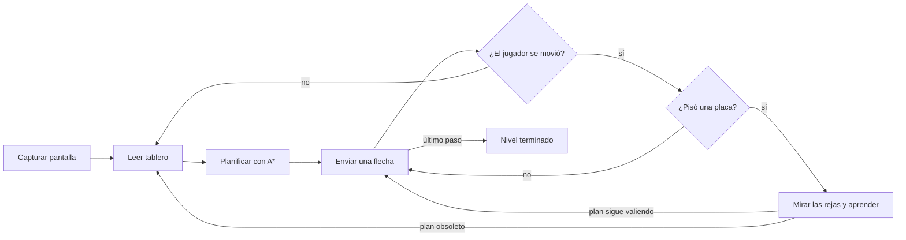
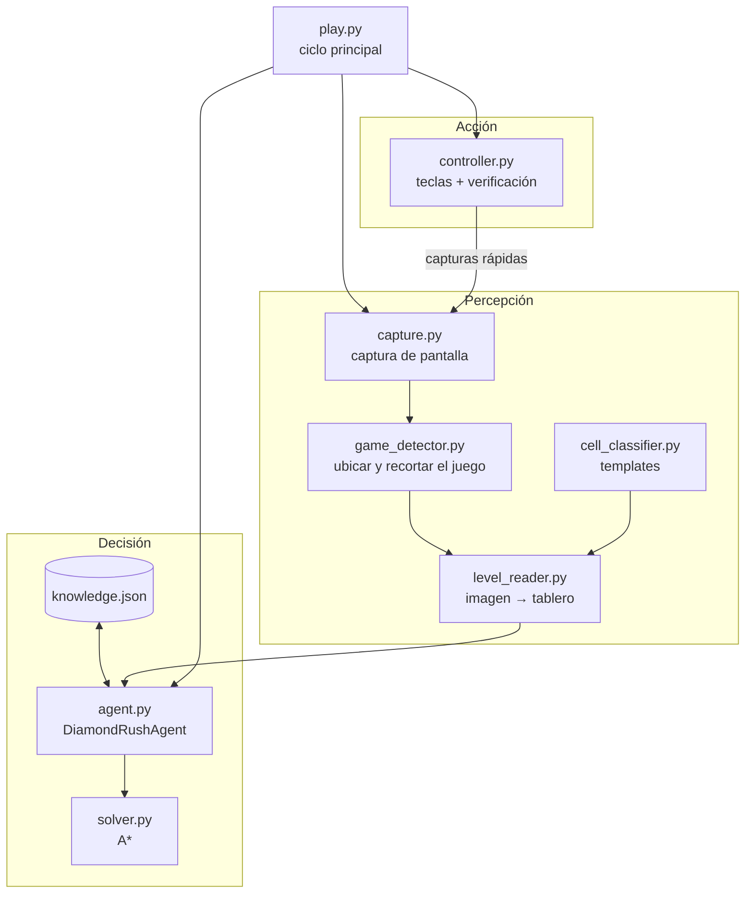
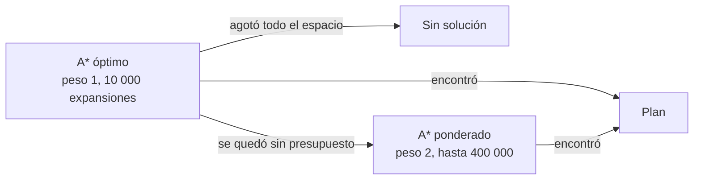

# Guía técnica del agente

Esta guía explica **qué hace el agente, cómo lo hace y por qué** se tomó cada
decisión, con el detalle suficiente para entender el código y poder explicarlo.
Para instalar y usar el agente, ver el [README](../README.md).

Contenido:

1. [Visión general](#1-visión-general)
2. [Arquitectura](#2-arquitectura)
3. [Percepción: de la pantalla al tablero](#3-percepción-de-la-pantalla-al-tablero)
4. [Modelo del juego](#4-modelo-del-juego)
5. [Planificación: el solver](#5-planificación-el-solver)
6. [Ejecución y corrección](#6-ejecución-y-corrección)
7. [Aprendizaje: rejas y placas](#7-aprendizaje-rejas-y-placas)
8. [Rendimiento](#8-rendimiento)
9. [Exploración opcional](#9-exploración-opcional)
10. [Robustez entre máquinas](#10-robustez-entre-máquinas)
11. [Pruebas](#11-pruebas)
12. [Limitaciones conocidas](#12-limitaciones-conocidas)
13. [Preguntas frecuentes para la sustentación](#13-preguntas-frecuentes-para-la-sustentación)

---

## 1. Visión general

Es un **agente basado en objetivos** (en la clasificación de Russell y Norvig): tiene
un modelo del mundo (el tablero), un objetivo (recoger todos los diamantes y llegar a
la salida) y **busca** la secuencia de acciones que lo cumple antes de actuar.

Su ciclo es:



Entorno, en términos del curso:

| Propiedad | Diamond Rush | Consecuencia en el diseño |
|---|---|---|
| Observable | Casi totalmente: todo el nivel está en pantalla, salvo qué placa abre qué reja y lo que hay debajo de las rocas | El agente supone y **aprende** lo oculto (secciones 5.6 y 7) |
| Determinista | Sí | Se puede planificar el nivel completo de una vez |
| Estático | Sí (nada se mueve si el jugador no se mueve) | Planificar no tiene apuro de tiempo real |
| Discreto | Sí: cuadrícula, 4 acciones | Búsqueda en grafos |
| Un agente | Sí | Búsqueda clásica, no adversaria |

---

## 2. Arquitectura



| Módulo | Responsabilidad |
|---|---|
| `play.py` | Punto de entrada y ciclo principal: captura, planifica, ejecuta, replanifica, pasa de nivel, mide los tiempos. |
| `config.py` | Ajustes de velocidad y tiempos desde `.env` o variables de entorno. |
| `capture.py` | Captura de pantalla completa (`pyautogui`) y de una región (rápida, para vigilar el juego). |
| `game_detector.py` | Encuentra el juego en la pantalla con el ancla (engranaje) a cualquier escala y lo recorta. |
| `level_reader.py` | Clasifica cada celda del recorte y arma el tablero lógico. |
| `cell_classifier.py` | Carga los templates de `assets/templates/cells/`. |
| `board_classifier.py` | Constantes de la cuadrícula (origen y tamaño de celda). |
| `agent.py` | El agente: percibe, recuerda el nivel en curso, llama al solver y aprende de las rejas. |
| `solver.py` | Planificador: reglas del juego y búsqueda A\*. |
| `controller.py` | Envía las flechas y comprueba en pantalla que cada movimiento ocurrió. |
| `image_io.py` | Lectura/escritura de imágenes que funciona con cualquier ruta. |
| `stitcher.py`, `explorer.py` | Exploración opcional de niveles que no caben en pantalla (`--explore`). |

La separación sigue el esquema **percepción → decisión → acción**: el solver no sabe
nada de imágenes y el lector no sabe nada de reglas; se comunican solo a través del
tablero (una lista de filas de símbolos).

---

## 3. Percepción: de la pantalla al tablero

### 3.1 Ubicar el juego (`game_detector.py`)

El juego puede estar en cualquier parte de la pantalla y a cualquier tamaño (zoom del
navegador, escala de Windows, pantallas Retina). Se usa un **ancla**: el engranaje de
configuración, que está siempre en la misma posición relativa al juego.

1. **Template matching** (`cv2.matchTemplate`, correlación normalizada
   `TM_CCOEFF_NORMED`) del engranaje sobre la pantalla. Si la coincidencia es ≥ 0.80,
   el juego está a tamaño natural.
2. Si no, **búsqueda de escala** en dos pasos:
   - *gruesa*: se prueba el engranaje achicado para escalas de 0.50 a 2.00 en pasos de
     0.05 (achicar el template es mucho más barato que agrandar la pantalla);
   - *fina*: alrededor de la mejor, ±0.04 en pasos de 0.02, escalando la pantalla.
3. Con la posición del ancla y un desplazamiento fijo se recorta el área del juego, que
   siempre se lleva a **452 × 638 píxeles**: todo lo que sigue trabaja a ese tamaño.

Esta búsqueda sobre la pantalla completa se hace una sola vez por nivel; las capturas
siguientes son solo de esa región, mucho más rápidas, y se reescalan a 452 × 638.

### 3.2 Geometría

El tablero tiene **10 columnas × 12 filas** de 42 × 43 píxeles, desde `x = 0`,
`y = 82`. La primera fila queda **tapada por el HUD**: solo se ven sus 22 líneas de
abajo, así que en ella se distingue menos (muro, piso, diamante, jugador, roca).

### 3.3 Clasificar una celda (`level_reader.classify_cell`)

Cada celda se compara con todos los templates, pero no píxel a píxel:

1. **Miniatura de color**: la celda se reduce a 8 × 8 píxeles (`INTER_AREA`, que
   promedia). Comparar a baja resolución tolera pequeños desplazamientos y la animación
   del jugador, y sigue distinguiendo bien colores y formas grandes.
2. **Distancia**: media del valor absoluto de la diferencia (L1) entre la miniatura y la
   de cada template. Gana la más cercana; si ninguna baja de **38**, la celda es
   desconocida (`?`), salvo que sea muy clara (muro con una decoración nueva).

La miniatura sola confunde algunos pares, así que se agregan **medidas de color**
calculadas sobre la celda completa:

| Medida | Qué cuenta | Para qué sirve |
|---|---|---|
| Píxeles cian | azul ≫ rojo | Solo llaves y diamantes son cian; en zonas oscuras la miniatura los confundía con otras cosas. |
| Píxeles grises | sin el tono rojizo de la tierra | Huecos (fondo gris) y rejas (barrotes) frente a piso; placas frente a salida. |
| Puntos oscuros | píxeles mucho más oscuros que su entorno | Los agujeros de las púas son demasiado pequeños para la miniatura. |
| Píxeles negros | casi negros | Un hueco rellenado (roca rodeada del borde negro del foso) frente a una roca suelta. |
| Puntas claras | grises y brillantes en el centro | Púas ya levantadas. |

Los huecos (`H`) y las púas levantadas (`X`) se detectan solo por estas medidas, sin
templates. Todos los umbrales están en `level_reader.py` con un comentario que dice
de qué niveles salió cada valor.

### 3.4 El jugador

El jugador está animado y a veces no coincide con sus templates. Si en todo el tablero
no se reconoció ningún jugador, se elige la celda libre más parecida a ellos (si la
distancia no pasa de 45). Además, al replanificar a mitad de un nivel se usa la
posición que el controlador **vio** llegar al jugador, que es más fiable que la imagen.

---

## 4. Modelo del juego

### 4.1 Símbolos

| Símbolo | Objeto | Reglas |
|---|---|---|
| `#` | Muro | Bloquea. |
| `.` | Piso | Libre. |
| `P` | Jugador | |
| `D` | Diamante | Se recoge al pisarlo. Una roca puede pasar por encima. |
| `E` | Salida o meta (reja de salida, estatua) | Solo se abre con todos los diamantes. |
| `R` | Roca | Se empuja una casilla si detrás hay piso, un diamante, un hueco, una placa, púas sin activar, una llave ya recogida, una puerta abierta o una reja abierta. |
| `H` | Hueco | No se puede pisar. Una roca empujada dentro lo rellena y queda piso. |
| `K` | Llave | El jugador carga **una** llave a la vez. |
| `G` | Puerta | Se abre gastando una llave. |
| `O` | Placa de presión | Abre su reja mientras tiene una roca encima. |
| `B` | Reja | Se cruza solo si su placa tiene una roca. |
| `S` | Púas | Se pisan una vez; al salir, suben. |
| `X` | Púas levantadas | Bloquean. |
| `L` | Lava | Bloquea. |
| `?` | Desconocido | Se trata como obstáculo. |

Estas reglas están escritas como constantes al principio de `solver.py`
(`REQUIRE_ALL_DIAMONDS`, `SPIKES_SINGLE_USE`, `MAX_KEYS_IN_HAND`, `ROCK_LANDING`), así
que cambiar una regla es cambiar una línea.

### 4.2 Estado

Un estado del nivel es la tupla:

```
(posición, diamantes recogidos, llaves recogidas, llaves en la mano,
 puertas abiertas, púas usadas, posiciones de las rocas, huecos rellenados)
```

Los conjuntos de diamantes, llaves, puertas, púas y huecos son **máscaras de bits**
(cada objeto un bit), y las rocas un `frozenset`. Así el estado es inmutable y se
puede guardar en diccionarios y conjuntos para no repetir estados.

---

## 5. Planificación: el solver

### 5.1 Acciones de alto nivel (macro-acciones)

Buscar paso a paso es inviable: un nivel tiene ~100 movimientos. La idea clave es que
**caminar no cambia el nivel**: todas las casillas a las que el jugador llega sin
empujar, recoger ni gastar nada forman una **región**, y dos estados que solo difieren
en dónde está el jugador dentro de la misma región son, para la búsqueda, el mismo.

Por eso cada expansión (`explore` en `solver.py`):

1. Recorre en anchura (BFS) la región del jugador.
2. Devuelve como acciones solo los pasos que **sí** cambian algo: empujar una roca,
   recoger un diamante o una llave, abrir una puerta, salir de una trampa, llegar a la
   salida. Cada acción lleva el camino a pie hasta ahí, cuyo largo es su costo.

La búsqueda pasa así a ser sobre decisiones (qué empujar, qué recoger) y no sobre
pasos, lo que reduce el espacio en órdenes de magnitud. Es la misma idea que usan los
solvers de Sokoban.

### 5.2 A\* en dos etapas



1. **A\* óptimo** (`f = g + h`) con un presupuesto de 10 000 expansiones: si encuentra
   plan, es el más corto. En la mayoría de los niveles basta.
2. Si no alcanza, **A\* ponderado** (`f = g + 2·h`): ya no garantiza el plan más corto,
   pero encuentra uno válido mucho antes. En esta etapa además:
   - se suma un castigo de 5 por cada diamante sin recoger, para preferir estados con
     más diamantes;
   - recoger un diamante o una llave al alcance se hace siempre, sin considerar
     alternativas (nunca perjudica);
   - los estados se identifican por región, no por casilla exacta.

`g` es la cantidad de movimientos hechos; `h` se explica a continuación.

### 5.3 Heurísticas

**Con diamantes pendientes**: hay que pasar al menos por el diamante más costoso y
después ir a la salida:

```
h = máx sobre diamantes d sin recoger de ( |pos − d| + |d − salida| )
```

(distancias Manhattan). Es **admisible** (nunca sobreestima), así que la primera etapa
da planes óptimos.

**Sin diamantes pendientes**: la distancia Manhattan a la salida. Para la etapa
ponderada, si el camino a la salida pasa por huecos (nivel 20: la estatua está
encerrada tras tres huecos), se usa además una estimación de **rocas a huecos**:

1. Al empezar, se calcula el camino más barato a la salida pasando por encima de todo
   (cruzar un hueco cuesta 8, una roca 2): los huecos de ese camino son los que hay que
   rellenar.
2. Para cada uno de esos huecos se precalcula, con un BFS hacia atrás que solo mira los
   muros, cuántos empujones necesita una roca desde cada casilla para caer en él (la
   roca se mueve si el jugador puede pararse detrás).
3. En cada estado, a cada hueco pendiente se le asigna (de forma voraz) la roca libre
   más cercana, y se suman esas distancias × 5.

Con la distancia en línea recta el nivel 20 no se resolvía ni en 10 minutos: acercar
una roca a un hueco no acercaba la estimación a la meta. Con esta heurística sale en
~6 s. Es la heurística clásica de asignación de cajas a metas de Sokoban.

### 5.4 Presupuestos

| Constante | Valor | Para qué |
|---|---|---|
| `OPTIMAL_EXPANSIONS` | 10 000 | Etapa óptima |
| `CAUTIOUS_EXPANSIONS` | 30 000 | Etapa ponderada en los intentos cautelosos (5.5) |
| `MAX_EXPANSIONS` | 400 000 | Último intento, antes de rendirse |
| `FALLBACK_WEIGHT` | 2 | Peso de `h` en la etapa ponderada |
| `MAX_LINK_OPTIONS` | 60 | Emparejamientos reja-placa que se prueban |

### 5.5 Púas ocultas bajo las rocas

Debajo de una roca puede haber una trampa que no se ve hasta moverla. Por cautela, cada
intento se hace primero suponiendo que **toda casilla que empieza con roca es una
trampa de un solo uso**; si así no hay plan, se repite sin esa suposición.

### 5.6 Rejas y placas: decidir sin saber

El juego **no muestra qué placa abre qué reja**. El solver:

1. Enumera los emparejamientos posibles (permutaciones), del de menor distancia total
   al de mayor, descartando los que el agente ya sabe falsos (sección 7).
2. Primero busca un **plan robusto**, que vale para todos los emparejamientos posibles:
   no cruza una reja hasta tener rocas en *todas* las placas que podrían ser la suya.
   Equivocarse de placa suele dejar las rocas donde ya no sirven, sin arreglo.
3. Si no existe, prueba cada emparejamiento concreto, del más probable al menos. Un
   nivel siempre tiene solución, así que un emparejamiento sin plan no puede ser el
   real.

Para cada candidato se hacen los dos intentos de 5.5 (con y sin púas ocultas).

### 5.7 Replanificar a mitad de nivel

El solver recibe también las llaves que el jugador ya trae (no se ven en el tablero) y
las placas tapadas por rocas, así que puede planificar desde cualquier momento del
nivel, no solo desde el inicio.

---

## 6. Ejecución y corrección

### 6.1 Cada movimiento se comprueba (`controller.py`)

El agente no manda los ~100 movimientos a ciegas. Para cada uno:

1. Pulsa la flecha (60 ms).
2. Captura la región del juego cada 30 ms y mide cuánto cambiaron la casilla de origen
   y la de destino (diferencia media de sus miniaturas). El movimiento se da por hecho
   cuando **ambas** cambiaron (más de 10) y la de destino al menos un 60 % de lo que
   cambió la de origen. Si el jugador choca contra una reja, se gira y su sombrero
   asoma en la casilla vecina, pero ese cambio es mucho menor.
3. Si en 1 s no pasó nada, vuelve a pulsar (hasta 3 veces). Si aun así no se movió,
   el movimiento está **bloqueado**.
4. Espera a que la animación termine antes del siguiente paso: empujar una roca o
   abrir una puerta tarda más que caminar. La imagen tiene que quedarse sin cambios
   durante `DR_STILL_TIME` (0.1 s), comparando contra la última captura en la que algo
   cambió. Comparar solo dos capturas seguidas no alcanza: el juego dibuja por
   cuadros y, capturando rápido, dos capturas pueden caer en el mismo cuadro a mitad
   de un empujón. Si se pulsa en ese momento, el juego ignora la flecha, el final de
   la animación anterior parece el movimiento nuevo y el agente pierde la cuenta de
   dónde está el jugador. Eso pasó en el nivel 19 con el perfil rápido, y se
   reprodujo en simulación antes de corregirlo.
5. Solo vuelve a pulsar si la pulsación se perdió (ni la casilla del jugador ni la de
   destino cambiaron). Si algo cambió sin ser el movimiento esperado, el jugador no
   está donde se cree: pulsar otra vez lo alejaría más, así que se detiene y vuelve a
   leer el tablero.

El último paso entra en la salida y el nivel cambia, así que no se comprueba igual
que los demás, pero sí que la casilla cambió: si la pulsación se pierde, se repite.
Sin eso, el agente daría por ganado un nivel que no terminó.

Todos estos tiempos (60 ms, 30 ms, 1 s, 3 pulsaciones...) son ajustes de `config.py`,
que se cambian en `.env` sin tocar el código (ver el README). Como cada movimiento se
comprueba en pantalla, bajar las pausas acelera al agente sin que se salte pasos: si
va demasiado rápido para la máquina, un movimiento sale como bloqueado y el agente
replanifica.

### 6.1.1 Mantener la flecha pulsada (opcional)

Con `DR_HOLD_KEYS=1`, `controller.walking_run` busca tramos del plan que se puedan
recorrer como lo haría una persona, manteniendo la flecha:

- al menos `DR_HOLD_MIN_RUN` movimientos seguidos en la misma dirección;
- todas las casillas son piso, diamantes o huecos ya rellenados, sin rocas (el
  controlador lleva la cuenta de las rocas empujadas y los huecos rellenados durante
  el plan);
- **la casilla siguiente al tramo es un muro** (o el borde del tablero).

La última condición es la que lo hace seguro: el controlador suelta la tecla al ver al
jugador entrar en la última casilla, y si la suelta un poco tarde el jugador choca con
el muro en lugar de dar un paso que el plan no prevé (que podría caer en púas o
empujar una roca). No se usa en tramos con placas, púas, llaves, puertas o rejas, ni
en el último movimiento (la entrada a la salida).

`hold_run` pulsa la flecha, sigue en pantalla cuántas casillas del tramo recorrió el
jugador y suelta al llegar a la última o si en `DR_MOVE_TIMEOUT` no entra en la
siguiente. Después mira dónde quedó: las casillas de piso por las que pasó vuelven a
verse como antes y las que siguen a donde se detuvo no cambiaron, así que la última
casilla que cambió es donde está. Si se quedó corto, el resto del tramo se hace con
una pulsación por casilla y la opción se apaga para toda la sesión: el juego no mueve
al jugador con la tecla pulsada.

Se probó en simulación con dos comportamientos del juego (camina mientras la tecla
está pulsada / se mueve una casilla por pulsación): en ambos el jugador termina en la
salida, y en el primero cada tramo se hace de una vez.

### 6.1.2 Menos capturas por movimiento

Cada movimiento se vigila con capturas, así que su costo manda en la velocidad del
teclado. Además de la captura rápida (sección 10), el controlador reutiliza capturas:
la que confirmó el movimiento es el punto de partida de la espera "hasta que quede
quieto", y la última captura quieta sirve como "antes" del movimiento siguiente. Se
descarta (y se vuelve a capturar) cuando algo pudo cambiar la pantalla mientras tanto:
al pisar una placa (se esperó a ver las rejas), al actualizar la cámara o después de
un tramo con la flecha pulsada.

### 6.1.3 Tiempos medidos

`play.py` mide cada nivel con `LevelTimer`: el tiempo de **lectura y plan** (captura,
lectura del tablero y búsqueda, sumando replanificaciones), el de **teclado** (enviar
y comprobar los movimientos, y explorar si se usa `--explore`) y el **total** desde
que empezó a mirar el nivel hasta enviar el último movimiento. Cada plan muestra
además su tiempo de cálculo.

### 6.2 Replanificación (`play.py`)

| Situación | Reacción |
|---|---|
| Movimiento bloqueado | Vuelve a leer el tablero y replanifica desde donde quedó (hasta `--replans` veces). |
| Bloqueado contra una puerta con "llave en la mano" | La cuenta de llaves estaba mal (una celda leída como llave no lo era): la pone en 0 y replanifica. |
| El primer movimiento no tuvo efecto | El juego no recibe las teclas o el tablero está mal: se detiene. |
| Al pisar una placa, la reja no hace lo esperado | Aprende (sección 7) y replanifica. |
| No se ve la salida | Se detiene: casi seguro es un objeto sin template. |

Al replanificar, el agente **recuerda el nivel**: qué celdas eran rejas y placas (una
reja abierta no se ve como reja, una placa con roca encima no se ve como placa), dónde
está el jugador y cuántas llaves lleva.

La posición del jugador que llevó el controlador se prefiere a la de la imagen (la
animación del jugador no siempre coincide con los templates), salvo que en esa
casilla se vea una roca o un muro: entonces el controlador perdió la cuenta, y si el
jugador se ve claramente en otra casilla, se usa esa (`agent.restore`).

---

## 7. Aprendizaje: rejas y placas

Cuando algo (el jugador o una roca empujada) pisa una placa, el agente espera a que la
reja termine de moverse (0.4 s más hasta que la imagen se quede quieta) y mira todas
las rejas:

- Una reja que **sigue cerrada** no es de ninguna de las placas que tienen peso encima.
- Una reja que **se abrió** solo puede ser de alguna de esas placas: se descartan todas
  las demás.

Los pares (reja, placa) descartados se guardan en `knowledge.json`, con el tablero
inicial del nivel como clave, y se reutilizan en las partidas siguientes: la segunda
vez que se juega un nivel, el solver ya sabe más. Si lo aprendido llegara a descartar
todas las placas de una reja (algo se observó mal), se ignora lo aprendido sobre esa
reja.

---

## 8. Rendimiento

Tiempos de planificación sobre los 20 tableros de prueba (19 capturas + nivel 20):

| Cambio | Total | Nivel 20 | Nivel 10 (a medias) | Planes |
|---|---|---|---|---|
| Antes | 54.5 s | 28.8 s | 12.9 s | |
| Caminar por piso sin llamar a `step()` | 43.5 s | 23.1 s | 9.8 s | idénticos |
| Sin muros en la lista de vecinos; caminos armados solo para el plan final | 41.0 s | 22.1 s | | idénticos |
| Huecos rellenados tratados como piso directamente | 40.8 s | 21.6 s | | idénticos |
| `HOLE_ROCK_WEIGHT` 3 → 5 | 27.6 s | 8.5 s | | nivel 20: 110 → 108 movimientos |
| `CAUTIOUS_EXPANSIONS` 100 000 → 30 000 | **18.5 s** | **6.4 s** | **2.9 s** | idénticos |

Qué se hizo:

- **Perfilado primero** (`cProfile`): el 80 % del tiempo se iba en `explore` y `step`,
  con 22 millones de llamadas a `step` en el nivel 20.
- **Camino rápido al caminar**: entrar a una casilla de piso, placa o hueco ya
  rellenado sin roca encima no cambia nada, así que el BFS de la región la agrega
  directamente. Las llamadas a `step` bajaron de 22 a 7.5 millones; el resultado es
  exactamente el mismo.
- **Vecinos precalculados sin muros**: los muros no cambian nunca.
- **Caminos perezosos**: cada acción guardaba su camino completo, pero solo se usan los
  del plan final. Ahora guarda una referencia y el camino se arma al final.
- **Asignación de rocas a huecos con listas ordenadas** precalculadas.
- **Parámetros medidos, no adivinados**: se probaron varias combinaciones de peso,
  castigo y presupuesto sobre todos los niveles, mirando tiempo **y** largo de los
  planes (cada movimiento se comprueba en pantalla y cuesta unas décimas de segundo,
  así que un plan más largo también es más lento). Con `CAUTIOUS_EXPANSIONS` en 10 000 ningún plan cambió; se
  dejó en 30 000 para tener margen.

Las optimizaciones que no cambian resultados se verificaron comparando los planes de
todos los niveles antes y después.

---

## 9. Exploración opcional

`--explore` (apagado por defecto) cubre el caso de un nivel más grande que la
pantalla. En Diamond Rush no hace falta (todo nivel se ve entero), pero el código está
probado y queda disponible.

- `stitcher.py` arma un **mapa** con varias capturas: tras cada movimiento ubica la
  vista dentro de lo ya visto con template matching (primero a media resolución y luego
  afinando) y la pega en su lugar. El HUD y el botón WALKTHROUGH, que no se mueven con el
  nivel, se excluyen. Las celdas nunca vistas son `~` (bloqueadas para el solver).
- `explorer.py` lleva al jugador hacia los bordes sin ver: primero **solo caminando**
  por piso y diamantes (no cambia el nivel); si así no se ve más y lo visto no alcanza
  para terminar, usa el solver para llegar junto a un borde, aunque haya que empujar
  rocas.

Está apagado porque, si falta la salida, lo más probable es un objeto sin template, y
explorar podría empujar rocas y dejar el nivel sin solución. Sin explorar, el agente
se detiene con el nivel intacto.

---

## 10. Robustez entre máquinas

| Problema | Solución |
|---|---|
| Distinto tamaño de pantalla, zoom del navegador, escala de Windows | Búsqueda del juego a escalas de 0.5 a 2.0 (3.1); todo se procesa a 452 × 638. |
| `cv2.imread`/`cv2.imwrite` fallan sin avisar con rutas no ASCII en Windows (`C:\Users\Sebastián\...`) | `image_io.py` lee y escribe los bytes con NumPy y decodifica en memoria. Probado con una carpeta `Sebastián Ñandú`. |
| `knowledge.json` dependía de la codificación del sistema | Se lee y escribe siempre en UTF-8. |
| Una consola que no puede mostrar una tilde hacía fallar `print` | La salida reemplaza los caracteres que no puede mostrar. |
| `requirements.txt` estaba en UTF-16 | Pasado a UTF-8. |
| Rutas relativas al directorio actual | Las rutas se arman desde la ubicación de los archivos (`Path(__file__)`). |
| Máquinas lentas | Cada movimiento espera a ver el cambio en pantalla en lugar de usar tiempos fijos; los tiempos se ajustan por máquina en `.env` (que no se sube a git). |
| Ajustes mal escritos | `config.py` avisa y usa el valor por defecto en lugar de fallar. |
| Captura rápida | En Linux se usa X11 directo (~20 ms). En Windows y macOS se usa `mss`, que copia solo el área del juego (~17 ms contra ~33 ms de `PIL.ImageGrab`, que en Windows captura la pantalla entera y recorta); da exactamente los mismos píxeles en las mismas coordenadas. Si `mss` no está instalado o falla, se usa `PIL.ImageGrab` automáticamente. |

---

## 11. Pruebas

`src/test_solver.py`:

- Para cada nivel con captura en `dataset/raw/level_NNN/game_area.png`, lee el tablero,
  lo compara con el tablero **etiquetado a mano** y comprueba que hay plan.
- Para los niveles sin captura guardada (13 y 20), prueba solo el planificador con el
  tablero escrito.
- Imprime `Todo bien.` o la cantidad de errores, y termina con código 1 si hay errores.

Para agregar un nivel: `python dataset_collector.py --level N` con el nivel recién
empezado, y agregar su tablero a `EXPECTED` en `test_solver.py`.

---

## 12. Limitaciones conocidas

- **Objetos nuevos**: un objeto sin template se lee como desconocido (o como muro si es
  claro). Hay que agregar el template.
- **Niveles muy grandes o enredados**: la etapa ponderada tiene un límite de 400 000
  expansiones; un nivel que necesite más queda sin plan.
- **Reglas supuestas**: las del modelo (4.1) salieron de observar los niveles 1-20. Una
  mecánica nueva necesita una regla nueva en `solver.py`.
- **La heurística de huecos** usa los huecos de un único camino a la salida, calculado
  al inicio; en un nivel con varios caminos posibles puede guiar peor.
- **Monitor principal**: las capturas son del monitor principal.

---

## 13. Preguntas frecuentes para la sustentación

**¿Qué tipo de agente es?**
Basado en objetivos: tiene un modelo del mundo, un objetivo explícito y busca un plan
antes de actuar. Además aprende (rejas y placas) y vigila el resultado de cada acción.

**¿Por qué A\* y no BFS?**
BFS explora todo por igual; A\* va primero hacia donde la heurística dice que está la
meta. Con una heurística admisible el plan sigue siendo óptimo. Para los niveles
grandes se usa A\* ponderado, que sacrifica la optimalidad para encontrar un plan a
tiempo.

**¿La heurística es admisible?**
La de la primera etapa sí (Manhattan al diamante más costoso y de ahí a la salida;
nunca sobreestima). La de la etapa ponderada no lo es a propósito: castiga diamantes
pendientes y huecos sin roca para guiar más fuerte.

**¿Qué es una macro-acción y por qué importa?**
Agrupar todo lo que se puede caminar sin cambiar el nivel en una sola expansión. El
árbol pasa a tener una rama por decisión (empujar esta roca, recoger esta llave) en
lugar de una por paso, y dos posiciones de la misma región cuentan como un estado.

**¿Cómo sabe qué placa abre qué reja?**
No lo sabe al empezar. Prueba primero un plan que funcione para cualquier
emparejamiento posible; si no hay, prueba del más probable (más cercano) al menos.
Mientras juega, observa las rejas al pisar placas y descarta emparejamientos; eso se
guarda para la próxima vez.

**¿Cómo lee la pantalla sin hacer trampa?**
Solo con capturas de pantalla y visión por computadora (template matching y medidas de
color con OpenCV). No lee la página ni el código del juego.

**¿Qué pasa si se equivoca?**
Cada movimiento se comprueba en pantalla. Si uno no tiene efecto, vuelve a leer el
tablero y replanifica desde donde está. Si el error es de lectura, el tablero impreso y
`screenshots/last_game.png` muestran dónde.

**¿Cómo se midió que las optimizaciones no rompieron nada?**
Se guardaron los planes de los 20 tableros de prueba antes de cada cambio y se
compararon después: los cambios de código dan planes idénticos; los cambios de
parámetros se eligieron mirando tiempo y largo del plan en todos los niveles.
